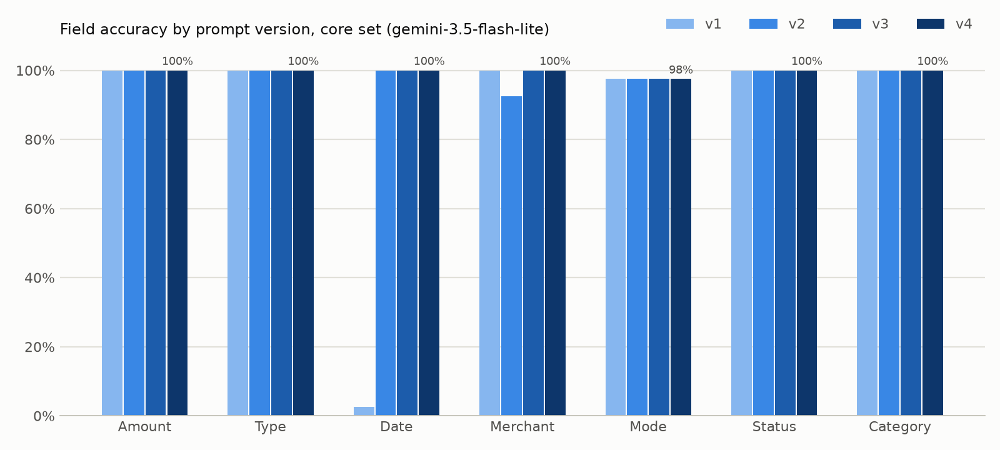
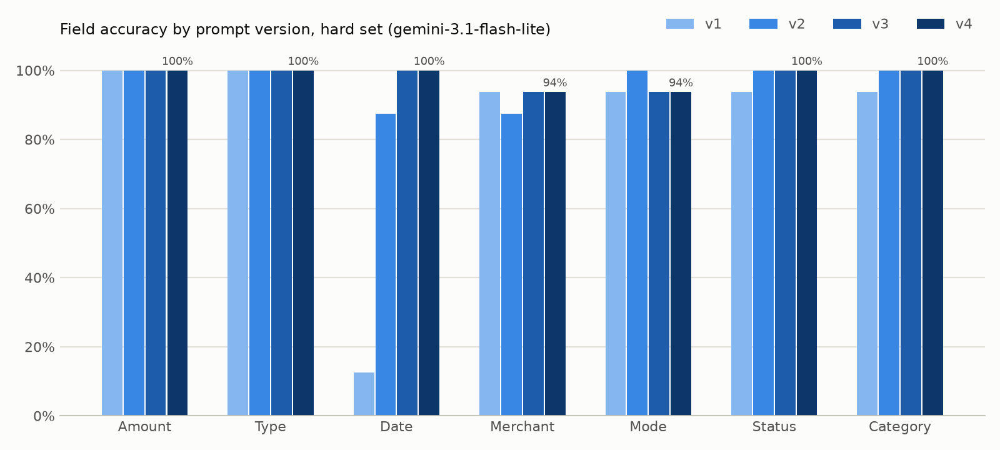

# SMS Expense Tracker: Project Report

**Course:** Prompt Engineering (class project)
**Author:** Sayan Mahalik

## 1. Introduction and problem statement

Every UPI payment, card swipe and bank transfer in India produces an SMS, and every bank words it
differently. The transaction messages sit among OTPs, promotions and balance alerts, and nobody adds them
up by hand. Rule-based parsers break when a bank changes a template; apps that solve the problem usually
want broad SMS permissions or a bank login.

This project asks whether careful prompting can turn raw SMS into reliable structured data. It builds
four versions of an extraction prompt, measures each on labelled messages, and wraps the best one in a
small tool: paste or upload SMS, get categorized transactions, a spending dashboard and a short written
summary.

**Result in one paragraph.** On 60 labelled SMS the final prompt reaches 99.6% field accuracy with perfect
transaction detection. The largest single gain comes from stating the output format and rules (v1 → v2:
85.7% → 98.6%), driven almost entirely by dates. Few-shot examples (v3) fix what the rules leave open:
on a harder 24-SMS set they stop the model inventing dates for messages that have none. The validation
and repair loop (v4) never fired, so in these runs v4 equals v3.

## 2. Related work

- **Regex and template parsers.** The traditional approach keeps one pattern per bank template. It is fast
  and exact on known formats and fails silently on new ones. This project's own noise filter showed the
  problem: the first version, written from memory of common formats, dropped 5 of 40 real transactions.
- **Expense-tracking apps.** SMS-reading apps such as Walnut (now axio) and Money View parse bank messages
  on the phone. They need SMS permission and their parsing rules are not open to inspection.
- **LLM information extraction.** Large language models can read unseen formats, but they can also return
  malformed output or invent values. The usual defences are schema-constrained output, explicit rules,
  few-shot examples and validation with retries. This project applies and measures each of them.

## 3. System architecture

```
raw SMS → [1] preprocess → [2] extract → [3] validate + repair → [4] categorize → [5] aggregate → [6] insights → dashboard
            Python          LLM            Python (+LLM in v4)     rules, then LLM   pandas          LLM
```

1. **Preprocess.** Parse the input (text, CSV, Android backup XML), drop noise with a keyword filter,
   remove duplicates, and mask account numbers, reference numbers, phone numbers and emails.
2. **Extract.** Send 30 SMS per call at temperature 0 with a JSON schema. One object comes back per message.
3. **Validate and repair.** Check each object against the schema, require type, amount and status for
   transactions, reject future dates, and check that the amount appears in the SMS text. In v4, a failing
   message is sent back with the error list, at most twice. Anything still invalid is shown under
   "Needs review" and never dropped.
4. **Categorize.** A merchant dictionary (about 110 keywords) and a few structural rules decide first.
   Merchants the rules don't know go to the LLM in one batched call.
5. **Aggregate.** pandas computes every number: totals, share by category, top merchants, weekly spend.
6. **Insights.** The LLM receives only the computed summary and writes three observations and two tips.
   A check confirms every rupee figure it cites exists in the summary.

Design principles: use the LLM only where rules fail, never let it do arithmetic, ground extracted values
in the source text, show uncertain rows instead of hiding them, and mask personal data before any API call.

## 4. Prompt design and iteration

| Version | What it adds | What it is meant to fix |
|---|---|---|
| v1 | One-line zero-shot instruction | Baseline |
| v2 | Role, field definitions, ten domain rules | Balance read as amount, "credited to X" inside a debit, promos counted as transactions, date formats |
| v3 | Six worked examples of hard cases | Failed payments, refunds, mandate reminders, missing dates |
| v4 | v3 plus the validation and repair loop in code | Invalid or ungrounded values |

All four versions run with the JSON schema enforced by the API, so the comparison isolates the prompt
text. The other prompts are a categorization prompt (fixed category list, "Other" when unsure) and an
insights prompt (may use only numbers from the summary).

Techniques used: role prompting, explicit schema, rule constraints, few-shot examples, a self-repair loop
with error feedback, grounding checks, abstention (`null`, "Other"), batching, rules-then-LLM routing,
and prompt chaining.

## 5. Experimental setup

**Data.** Two synthetic, hand-labelled sets modelled on real bank templates; no personal data.

| Set | SMS | Transactions | Contents |
|---|---|---|---|
| Core (`data/test_sms.csv`) | 60 | 40 | UPI, card, credits, ATM, autopay, refunds, failed and reversed payments; 20 negatives (OTPs, promos, reminders, balance alerts, loan offers) |
| Hard (`data/test_sms_hard.csv`) | 24 | 16 | Fees beside the amount, a foreign-currency spend, dates with no year or no date, truncated text, own-account transfer, standing instruction; 8 negatives (payment requests, due notices, cash on delivery, a revoked mandate) |

The six few-shot examples are in neither set.

**Metrics.** Detection precision, recall and F1 on "is this a transaction". Field accuracy over true
transactions for amount (±0.01), type, date, merchant (fuzzy match), payment mode, status and category.
Overall field accuracy is the mean of those seven.

**Constraints.** The free API tier allows 20 requests per day per model. Each configuration was therefore
run once, with 30 SMS per call, and the experiments are spread over three models:

| Experiment | Model |
|---|---|
| E1 prompt ablation (core), E2 pre-filter, E4 categorization | gemini-3.5-flash-lite |
| E1H prompt ablation (hard) | gemini-3.1-flash-lite |
| E3 batch size | gemini-4-hydrogen |

Each experiment is internally consistent; numbers should not be compared across experiments.

## 6. Results and analysis

### 6.1 Prompt ablation, core set (E1)

| Metric | v1 | v2 | v3 | v4 |
|---|---|---|---|---|
| Detection F1 | 1.000 | 1.000 | 1.000 | 1.000 |
| Amount | 1.000 | 1.000 | 1.000 | 1.000 |
| Type | 1.000 | 1.000 | 1.000 | 1.000 |
| Date | 0.025 | 1.000 | 1.000 | 1.000 |
| Merchant | 1.000 | 0.925 | 1.000 | 1.000 |
| Mode | 0.975 | 0.975 | 0.975 | 0.975 |
| Status | 1.000 | 1.000 | 1.000 | 1.000 |
| Category | 1.000 | 1.000 | 1.000 | 1.000 |
| **Overall field accuracy** | **0.857** | **0.986** | **0.996** | **0.996** |
| Tokens per SMS | 144 | 179 | 203 | 203 |



The core set is nearly saturated. With the schema supplying the field names, even the one-line prompt
finds every transaction, amount and status. What v1 lacks is the date format: it copies dates as written
(`04Nov26`). v2 fixes that and introduces one new mistake, naming the ATM as the merchant in three
withdrawals; v3's examples remove it.

### 6.2 Prompt ablation, hard set (E1H)

| Metric | v1 | v2 | v3 | v4 |
|---|---|---|---|---|
| Detection F1 | 1.000 | 1.000 | 1.000 | 1.000 |
| Amount | 1.000 | 1.000 | 1.000 | 1.000 |
| Type | 1.000 | 1.000 | 1.000 | 1.000 |
| Date | 0.125 | 0.875 | 1.000 | 1.000 |
| Merchant | 0.938 | 0.875 | 0.938 | 0.938 |
| Mode | 0.938 | 1.000 | 0.938 | 0.938 |
| Status | 0.938 | 1.000 | 1.000 | 1.000 |
| Category | 0.938 | 1.000 | 1.000 | 1.000 |
| **Overall field accuracy** | **0.839** | **0.964** | **0.982** | **0.982** |



The hard set separates the versions. All four still get every amount right, including the fee and
foreign-currency traps, and reject all eight negatives.

### 6.3 Before and after

| SMS | Before | After |
|---|---|---|
| "…debited by Rs.5,000.00 on 07Nov26; MOHIT ARORA credited…" | v1: date `07Nov26` | v2: `2026-11-07` |
| "…UPI txn of Rs.899.00 to MEESHO … was unsuccessful. Rs.899.00 has been credited back…" | v1: status `success`, category Shopping | v2: status `reversed`, category Refund |
| "Rs.2,150.00 debited … for UPI txn to MAKEMYTRIP could not be processed…" (no date in the text) | v2: date `2026-11-07`, invented | v3: date `null` |

The third row is the clearest case for few-shot examples. Rule 9 in v2 already says "never guess", yet the
model produced a date. One example showing `"date": null` for a failed payment changed the behaviour.

### 6.4 Pre-filter (E2)

| | Filter off | Filter on |
|---|---|---|
| SMS sent to the LLM | 60 | 44 |
| Tokens per SMS | 203 | 171 |
| Real transactions wrongly dropped | 0 | 0 |
| Overall field accuracy | 0.996 | 0.996 |

The filter removes 16 of the 20 negatives before any API call and costs no accuracy. The zero is a best
case: the filter was tuned on this set. On the hard set, checked offline, it drops 1 of 16 real
transactions (a standing instruction worded "charged") and lets 2 of 8 negatives through to the LLM.

### 6.5 Batch size (E3)

| SMS per call | Overall field accuracy | Requests | Tokens per SMS | Seconds per SMS |
|---|---|---|---|---|
| 10 | 1.000 | 7 | 531 | 2.69 |
| 30 | 0.996 | 3 | 421 | 1.24 |
| 60 | 1.000 | 2 | 279 | 0.75 |

Accuracy does not depend on batch size here (the single miss at 30 is one merchant). Larger batches
repeat the prompt less often, which roughly halves tokens and cuts time by a factor of 3.5. The app
therefore sends 30 per call.

### 6.6 Categorization (E4)

| | Rules only | LLM only | Hybrid |
|---|---|---|---|
| Category accuracy | 85% | 70% | 100% |
| Decided by rules (of 40) | 40 | 7 | 33 |
| API requests | 0 | 1 | 1 |

Rules alone miss merchants outside the dictionary and people's names. The LLM alone sees only merchant
names, so it cannot place rows that have none, such as ATM withdrawals. Rules first with the LLM as
fallback gets every row with one request.

### 6.7 Objectives

| Objective | Target | Result (core set, v4) |
|---|---|---|
| Detection F1 | ≥ 0.95 | 1.00 |
| Amount accuracy | ≥ 95% | 100% |
| Overall field accuracy | ≥ 90% | 99.6% |
| Category accuracy | ≥ 85% | 100% |
| Valid JSON rate | ≥ 99% | 100% |

## 7. Error analysis

Errors that remain in v3 and v4:

- **Mode inferred, not stated.** One SBI credit has no payment mode in the text; the model answers UPI
  from the template's look. A standing instruction charged to a card is returned as CARD, where the label
  follows the prompt's own rule and says AUTOPAY.
- **ATM as merchant.** On the hard set the model returns "ICICI Bank ATM" where the label is null. This is
  a labelling convention more than a mistake.

Weaknesses the numbers hide:

- **The repair loop was never exercised.** No output failed validation, so v4's value is unmeasured. The
  invented dates in v2 would not have been caught either: the date check only rejects future dates.
- **Temperature 0 is not deterministic.** An earlier, aborted attempt ran v1 twice on gemini-3.5-flash and
  measured date accuracy 0.30 and 0.175. Single runs are indicative, not exact.
- **Structured output hides the baseline's worst failure.** Without the schema, v1 would have chosen its
  own field names. The ablation measures prompt text given a schema, not the schema itself.

## 8. Privacy, limitations and ethics

- Account and card numbers, reference numbers, phone numbers and emails are masked before any API call.
  Merchant names and amounts are still sent to a third-party model.
- The insights prompt sees only aggregated numbers. SMS text is not written to disk.
- Both test sets are synthetic and were written by the same person who wrote the prompts and the filter,
  so they share blind spots. Real inboxes will be harder.
- One run per configuration and three different models: differences of one or two rows are within noise.
- English-language SMS only. The insights are generated text, not financial advice.

## 9. Conclusion and future work

For this task, most of the gain comes from two cheap steps: an enforced schema and a prompt that states
formats and domain rules. Few-shot examples earn their place on behaviours that rules describe but do not
enforce, such as returning null. Deterministic code around the model (filtering, grounding checks, rule
based categorization, arithmetic) cut cost and removed whole classes of error without any prompting.

Next steps:

- Add a date grounding check so invented dates trigger the repair loop, then measure v4 properly.
- Evaluate on real, anonymised SMS and repeat each configuration three times on one model.
- Run the same ablation without the schema to measure what structured output contributes.
- Hindi and regional-language SMS, a local model for full privacy, budgets and recurring-payment detection.
